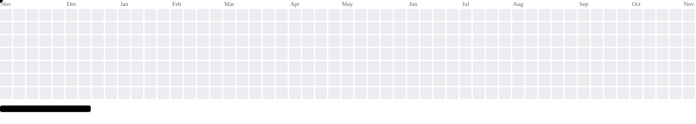

<picture>
  <source media="(prefers-color-scheme: dark)" srcset="https://raw.githubusercontent.com/NouBou1/NouBou1/pacman-output/breakout-contribution-graph-dark.svg">
  <source media="(prefers-color-scheme: light)" srcset="https://raw.githubusercontent.com/NouBou1/NouBou1/pacman-output/breakout-contribution-graph.svg">
  
</picture>

<h1 align="center">Hi, I'm Nouri 👋</h1>

  <strong>Tech in veins, code in brain.</strong>

  Fullstack Developer in training. Coming from a background as an HVAC mechanic and automotive enthusiast, I've always enjoyed understanding how complex things work—from engines to applications.

  I started with vanilla JavaScript. Right now I'm learning TypeScript, Angular and backend basics, one project at a time.

  <em>Learning, building, and exploring the digital stack.</em>

---

## 🚀 Featured Projects

| Project | What it is | Stack |
| --- | --- | --- |
| [Code à Cuisine](https://github.com/NouBou1/code-a-cuisine) | Recipe app | Angular · TypeScript · Firebase |
| [PollApp](https://github.com/NouBou1/pollApp) | Create polls, share them and watch results live | Angular · SCSS · Supabase |
| [SHK-ToolMate](https://github.com/NouBou1/SHK_Toolmate) | 20 calculators and project docs for HVAC work, PWA + Android app · [Live](https://shk-mate.n-boussaada.de) | JavaScript · Capacitor |
| [Join](https://github.com/NouBou1/join) | Kanban board for tasks, contacts and team workflows | JavaScript · Firebase |
| [Memory](https://github.com/NouBou1/memory_ts) | Two-player memory card game | TypeScript · Vite · SCSS |
| [El Pollo Loco](https://github.com/NouBou1/el_pollo_loco) | 2D jump 'n' run in the browser | JavaScript · Canvas |

---

## 🛠️ Tech Stack

### Languages

  

### Frameworks & Backend

  

### Tools

  

---

## 📫 Connect with me

  
  
  

---

  <em>Always open to new opportunities and collaborations!</em>

